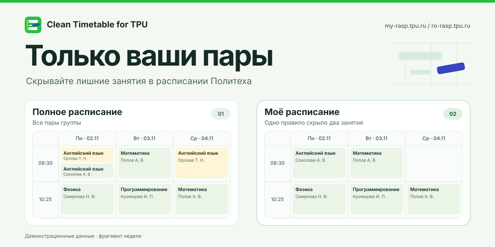

# Clean Timetable for TPU

[Русский](README.md)

Hide classes you don't need on the Tomsk Polytechnic University timetable. Both sites use the same rules for a group, stored locally in your browser. [my-rasp](https://my-rasp.tpu.ru/) · [ro-rasp](https://ro-rasp.tpu.ru/)

The extension follows your browser language. It supports Russian and English and defaults to Russian for other languages.

[Install for Firefox](https://addons.mozilla.org/en-US/firefox/addon/clean-timetable-for-tpu/)

## Install from source

Use Node.js 22.23.1 or later and run `npm ci` from the repository root. Build the version for your browser.

| Browser | Command | Load this build |
| --- | --- | --- |
| Firefox, Firefox ESR, Zen, LibreWolf, Waterfox, and Floorp on Gecko 142+ | `npm run build:firefox` | Open `about:debugging`, choose **Load Temporary Add-on**, and select `dist/tpu-schedule-filter-firefox-1.0.0.zip`. |
| Chrome, Edge, and other Chromium 109+ browsers | `npm run build:chromium` | Open the browser’s extensions page, enable developer mode, and select `dist/chromium/` with **Load unpacked**. |

Reload your group timetable. Look for **My timetable** above the table. Permanent installation in Firefox requires a signed add-on.

[Firefox guide](docs/en/firefox.md) · [Chromium guide](docs/en/chromium.md)

## Use the filter

Open **Configure** under a class.

- **Always hide** matches the subject, instructor, and class type across weeks for the same group. A lecture and a lab count as different classes.
- **Skip this class** hides one occurrence at the selected date and time.
- **Full timetable** shows hidden classes. **Restore this class** restores one occurrence and keeps the recurring rule in place.

Remove a recurring rule under **Recurring rules**. One-off skips remain in effect. The filter changes how your group's timetable appears in the browser.

## Develop

`npm run dev` loads the extension temporarily in Firefox. To use another Firefox-based browser, pass its path, for example `npm run dev -- --firefox /path/to/zen`.

### Repository layout

| Directory | Contents |
| --- | --- |
| `src/extension/` | Shared filtering code, timetable UI, and Firefox manifest |
| `src/chromium/` | Chromium API adapter and entry point |
| `scripts/` | Build scripts |
| `docs/` | Installation guides in Russian and English |
| `dist/` | Unpacked `firefox/` and `chromium/` builds and a ZIP for each browser |

## License

The code is distributed under the MIT License. [License text](LICENSE)
