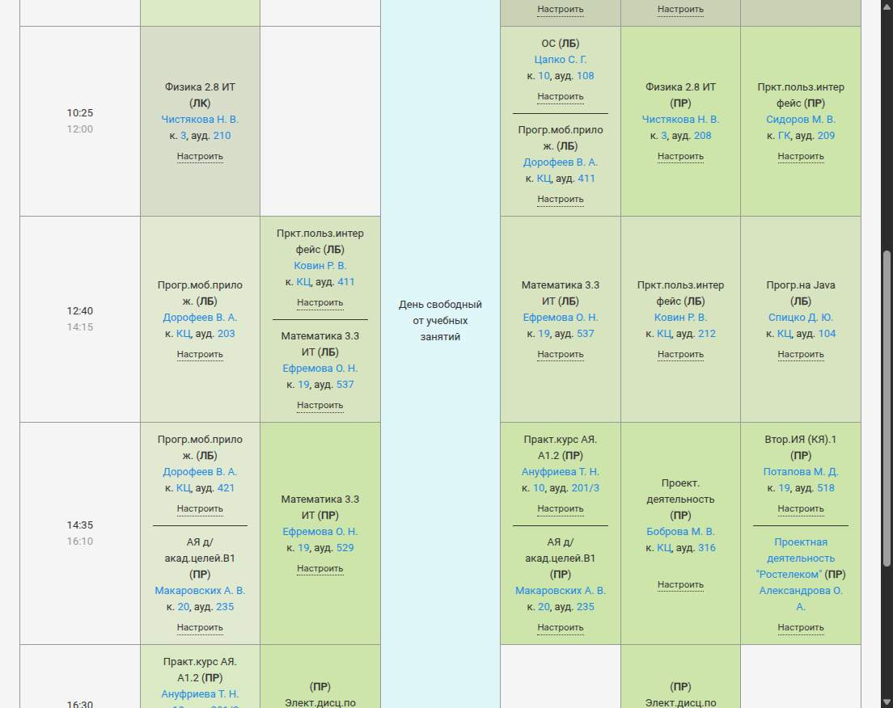

# ТПУ — моё расписание

Расширение для Firefox и Zen: убирает ненужные занятия из расписания на **my-rasp.tpu.ru**. Правила сохраняются только в браузере.

## Как пользоваться

1. Откройте расписание своей группы и нажмите **«Настроить»** под нужной парой.
2. **«Скрывать всегда»** — после подтверждения скрывает все занятия с теми же предметом, преподавателем **и типом**. Лекция не затрагивает практику или лабораторную. Правило действует на следующих неделях, только для этой группы.
3. **«Пропустить пару»** — скрывает только выбранные дату и время.
4. **«Полное расписание»** над таблицей показывает скрытые занятия с отметками. Нажмите «Вернуть эту пару» прямо у скрытого занятия, чтобы сделать исключение для одного занятия, сохранив постоянное правило.
5. Чтобы отменить постоянное скрытие, раскройте **«Постоянные правила»** и нажмите **«Отключить правило»**. Независимые разовые пропуски сохранятся.

Когда в ячейке остаётся одна пара, она центрируется во всей ячейке, а лишний разделитель исчезает. Сетка дней и времени сохраняется.



Снимок локального стенда на разметке ТПУ: в строке 12:40 скрыта лабораторная ОС у Цапко; занятие Ковина осталось по центру ячейки. Хранение на этом стенде имитировалось; проверка установки описана отдельно.

## Установка

Для проверки сейчас: откройте **`about:debugging#/runtime/this-firefox`**, нажмите **«Загрузить временное дополнение»** и выберите **`dist/tpu-schedule-filter-0.1.0.zip`**. Затем обновите страницу расписания.

**Zen из Flatpak:** сначала скопируйте ZIP в папку **«Загрузки»** и выберите архив оттуда. Выбор одного `manifest.json` через файловый портал может оставить соседние JS/CSS недоступными: расширение будет в списке, но панель не появится. Загрузка ZIP из «Загрузок» подтверждена пользователем. При разработке вне Flatpak можно выбирать `extension/manifest.json`.

Временное дополнение работает до перезапуска браузера. Для повседневной постоянной установки нужен пакет с подписью Mozilla; приложенный ZIP **ещё не подписан**. Переименование ZIP в XPI не добавляет подпись.

Подробности и путь к постоянной установке: [docs/installation.md](docs/installation.md).

Минимальная заявленная версия — Firefox 142; для Zen требуется соответствующая версия Gecko или новее. Временная загрузка проверена в Firefox 159.0 и Zen 1.24b (Gecko 159). Полная проверка установленного дополнения на живом сайте и сохранение после перезапуска с постоянной установкой пока не подтверждены. [Отчёт о проверках](docs/verification.md).

## Разработка

Нужны Node.js 22.23.1+ и npm. Версии инструментов закреплены в `package-lock.json`; jsdom используется только в тестах, `web-ext` — только для проверки, запуска и сборки.

```sh
npm ci
npm test
npm run check
npm run lint
npm run build
npm run dev
```

Если Firefox отсутствует в PATH, укажите исполняемый файл:

```sh
npm run dev -- --firefox /path/to/firefox
npm run dev -- --firefox /path/to/zen
```

Кнопки находятся прямо в расписании; отдельной кнопки на панели браузера нет. `npm run build` создаёт неподписанный ZIP в `dist/`. CI настроен на те же проверки, но удалённый запуск CI не выполнялся.

## Хранение и ограничения

- Ключ постоянного правила: группа + полное название предмета + ID преподавателя + тип. Если преподавателей несколько в одном блоке, сравнивается весь набор; если сайт разделяет их общей шапкой и линией, доступны отдельные действия.
- Разовый пропуск дополнительно привязан к календарной дате и времени начала. Перенос на другое время считается новым занятием; изменение аудитории не отменяет выбор.
- Данные в `browser.storage.local` сохраняются между перезапусками при постоянной установке. Удаление расширения, его данных или профиля может удалить правила. Синхронизации и резервного экспорта нет.
- Изменение названия предмета или преподавателя не расширяет старое правило автоматически. Нераспознанные блоки остаются видимыми.
- Поддерживаются настольные табличные расписания групп. Мобильный вид, iCal, печать через внешний сервис и страницы преподавателей не изменяются.
- Расширение не отправляет данные, не запрашивает cookies и историю и не изменяет расписание университета. Разрешение `storage` нужно для правил; скрипты подключаются только к страницам групп на домене ТПУ.

Источник данных и разметки: [ИПК «Расписание» ТПУ](https://my-rasp.tpu.ru/gruppa_44510/2026/10/view.html). Учебные HTML-примеры — очищенные от технических метаданных фрагменты публичного расписания с указанием источника.
