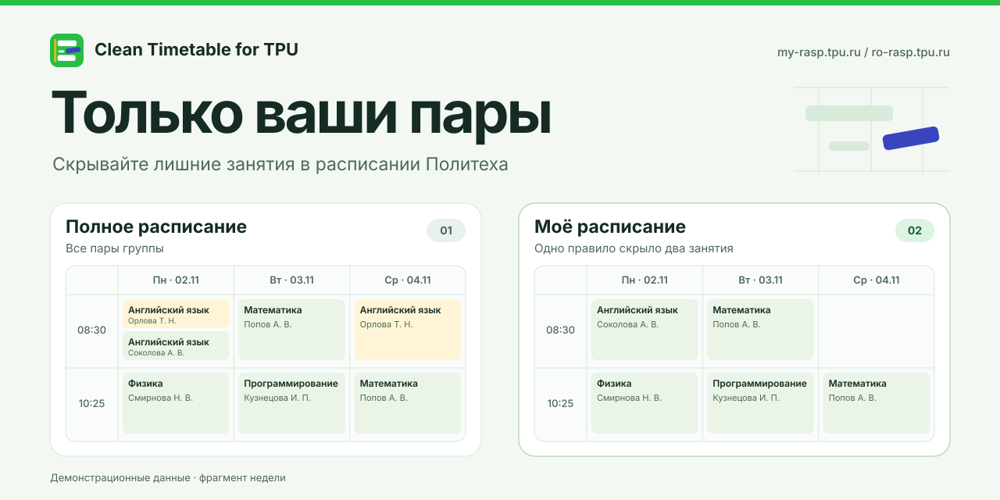

# Clean Timetable for TPU

[English](README.en.md)

Скрывайте ненужные пары в расписании Томского политехнического университета. Правила одной группы действуют на обоих сайтах и хранятся только в браузере. [my-rasp](https://my-rasp.tpu.ru/) · [ro-rasp](https://ro-rasp.tpu.ru/)

Интерфейс расширения следует языку браузера. Доступны русский и английский. Для остальных языков используется русский.

[Установить в Firefox](https://addons.mozilla.org/ru/firefox/addon/clean-timetable-for-tpu/)

## Установка из исходников

Установите Node.js 22.23.1 или новее. В корне проекта выполните `npm ci` и соберите версию для своего браузера.

| Браузер | Команда | Что загрузить |
| --- | --- | --- |
| Firefox, Firefox ESR, Zen, LibreWolf, Waterfox, Floorp на Gecko 142+ | `npm run build:firefox` | Откройте `about:debugging`, нажмите **«Загрузить временное дополнение»** и выберите `dist/tpu-schedule-filter-firefox-1.0.0.zip`. |
| Chrome, Edge и другие браузеры на Chromium 109+ | `npm run build:chromium` | На странице расширений включите режим разработчика, нажмите **«Загрузить распакованное расширение»** и выберите `dist/chromium/`. |

Обновите вкладку с расписанием группы. Над таблицей появится **«Моё расписание»**. Для постоянной установки в Firefox нужен подписанный пакет.

[Инструкция для Firefox](docs/firefox.md) · [Инструкция для Chromium](docs/chromium.md)

## Как пользоваться

Нажмите **«Настроить»** под нужной парой.

- **«Скрывать всегда»** скрывает совпадения по предмету, преподавателю и типу занятия на всех неделях этой группы. Лекция и лабораторная считаются разными занятиями.
- **«Пропустить пару»** скрывает одно занятие на выбранные дату и время.
- **«Полное расписание»** над таблицей показывает скрытые пары. Кнопка **«Вернуть эту пару»** делает исключение для одной даты, сохраняя постоянное правило.

Постоянное правило можно отключить в разделе **«Постоянные правила»**. Разовые пропуски сохранятся. Фильтр меняет отображение расписания группы в браузере.

## Разработка

`npm run dev` временно загружает расширение в Firefox. Для запуска в другом браузере на базе Firefox укажите путь к нему, например `npm run dev -- --firefox /path/to/zen`.

### Структура

| Папка | Содержимое |
| --- | --- |
| `src/extension/` | Общий код фильтрации, интерфейс расписания и манифест Firefox |
| `src/chromium/` | Адаптер API и точка входа Chromium |
| `scripts/` | Скрипты сборки |
| `docs/` | Инструкции на русском и английском |
| `dist/` | Распакованные сборки `firefox/` и `chromium/` и ZIP-архивы для каждого браузера |

## Лицензия

Код распространяется по лицензии MIT. [Текст лицензии](LICENSE)
